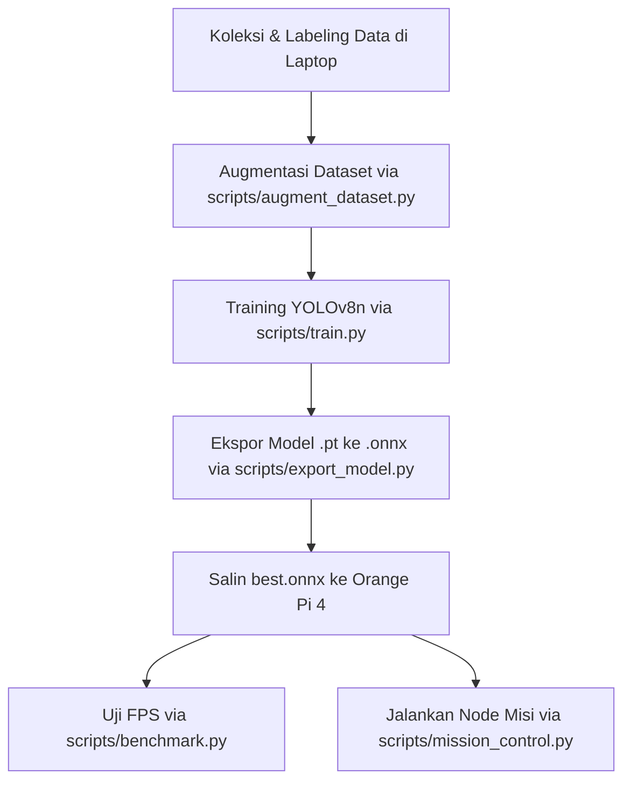

# KRTI VTOL 2026 — Machine Learning & Vision Pipeline

Repository ini berisi seluruh pipeline Machine Learning (ML) dan Computer Vision (CV) untuk drone VTOL Tim Robotik Sikonek UKM Robotik Universitas Sumatera Utara (USU) dalam ajang kompetisi **KRTI VTOL 2026**.

Pipeline ini dirancang khusus untuk berjalan secara efisien di **Orange Pi 4 (RK3399)** yang beroperasi menggunakan CPU-only (tidak memiliki NPU RK3588), dengan RAM 4GB, dan terintegrasi dengan flight controller (Pixhawk) melalui **MAVROS / ROS 2**.

---

## 📌 Fitur Utama & Desain Arsitektur

1. **Inference CPU Teroptimasi (Orange Pi 4)**
   - Menggunakan **YOLOv8n (nano)** dengan input resolusi **320×320** piksel.
   - Dijalankan via **ONNX Runtime CPU** dengan pembatasan multi-threading (`intra_op_num_threads=2`) untuk mencegah thermal throttling pada CPU ARM Cortex-A72 Orange Pi 4.
2. **Satu Kamera Fisik + Servo Tilting**
   - Mendukung kontrol servo pitch kamera (`0°` menghadap depan, `90°` menghadap bawah).
   - Dilengkapi sistem **Tilt Transition Cooldown (1.5 detik)** untuk meredam guncangan visual saat servo bergerak.
3. **Meredam Inersia & Overshoot (Centering Stabil)**
   - Dilengkapi filter **Exponential Moving Average (EMA)** pada bounding box untuk menghilangkan jitter sensor.
   - Menerapkan **Settling Timer (2.0 detik)**: Drone wajib stabil berada di tengah target sebelum melakukan aksi dropping payload (Red Box) atau landing (Landing Pad).
4. **Adaptive Line Follower**
   - Menggunakan **Otsu's Adaptive Thresholding** untuk menyesuaikan binarisasi garis hitam secara dinamis terhadap kondisi cahaya lintasan.
   - Menggunakan **Vertical Morphological Closing** untuk menjembatani celah garis putus-putus (*dashed line bridging*).
   - Memiliki **Centroid Hysteresis (Memory)** hingga 15 frame untuk mencegah drone kebingungan saat melewati celah garis putus-putus.

---

## 📂 Struktur Direktori

```text
ml/
├── configs/
│   ├── classes.json        # Single source of truth untuk ID kelas, deskripsi, dan warna visualisasi
│   ├── dataset.yaml        # Konfigurasi lokasi dataset untuk training YOLO
│   └── hyp_vtol.yaml       # Hyperparameter khusus augmentasi agresif drone
├── data/
│   └── dataset/            # Lokasi dataset gambar (images/train, images/val, labels/train, labels/val)
├── models/
│   ├── best.pt             # Bobot model PyTorch hasil training (Laptop)
│   └── best.onnx           # Bobot model ONNX hasil ekspor (Orange Pi 4)
├── scripts/
│   ├── augment_dataset.py  # Script augmentasi offline dataset di laptop
│   ├── benchmark.py        # Script uji performa FPS & Latency inferensi di Orange Pi 4
│   ├── export_model.py     # Script konversi bobot .pt ke .onnx resolusi 320x320
│   ├── hsv_calibrator.py   # Tool kalibrasi warna HSV secara real-time
│   ├── line_follower.py    # Logika deteksi garis hitam putus-putus (OpenCV)
│   ├── mission_control.py  # Node ROS 2 Utama (FSM & integrasi MAVROS Pixhawk)
│   ├── pid_controller.py   # PID Controller dengan Anti-Windup dan Slew Rate Limiter
│   ├── test_detector.py    # Uji coba visualisasi deteksi di webcam/video tanpa ROS
│   └── yolo_inference.py   # Wrapper inferensi ONNX Runtime CPU
├── vtol_detector.py        # Modul detector utama (Wrapper multi-class, EMA, servo-aware)
└── requirements.txt        # Daftar dependensi library python
```

---

## 💻 Panduan Alur Kerja (Workflow)

Alur kerja dibagi menjadi dua fase: **Fase Training di Laptop** (karena membutuhkan GPU/CPU besar) dan **Fase Inferensi di Orange Pi 4** (CPU ARM ringan).



### 1. Fase 1: Persiapan & Training (Di Laptop/PC)

#### A. Install Dependensi Laptop
```bash
pip install -r requirements.txt
# Pastikan PyTorch terinstall (opsional dengan CUDA untuk mempercepat training)
```

#### B. Augmentasi Dataset secara Offline
Gunakan script ini untuk menggandakan jumlah gambar latih secara artifisial (menambah variasi cahaya, getaran, posisi):
```bash
python scripts/augment_dataset.py --input_dir data/dataset --output_dir data/dataset_augmented --multiplier 3
```

#### C. Mulai Training Model
Script akan membaca konfigurasi di `configs/dataset.yaml` dan hyperparameter di `configs/hyp_vtol.yaml`:
```bash
python scripts/train.py --epochs 100 --imgsz 320
```
*Hasil model terbaik (`best.pt`) akan otomatis disalin ke folder `models/`.*

#### D. Ekspor Model ke ONNX (Resolusi 320x320)
Langkah krusial untuk mempercepat FPS di Orange Pi 4:
```bash
python scripts/export_model.py --weights models/best.pt --imgsz 320
```
*Script ini akan menghasilkan file `models/best.onnx`.*

---

### 2. Fase 2: Pengujian & Deployment (Di Orange Pi 4)

Pindahkan file `models/best.onnx` dari laptop ke folder `models/` pada Orange Pi 4 menggunakan `scp` atau USB Flashdisk.

#### A. Install Dependensi di Orange Pi 4
Di Orange Pi 4, kita **tidak butuh** PyTorch (`torch`) atau `ultralytics` yang sangat berat. Cukup install:
```bash
pip install numpy opencv-python onnxruntime
```

#### B. Uji Performa Inferensi (Benchmark FPS)
Jalankan benchmark untuk memastikan model berjalan stabil pada frame rate yang diharapkan di CPU Orange Pi 4:
```bash
python scripts/benchmark.py --model models/best.onnx
```

#### C. Uji Deteksi Visual Tanpa ROS (Menggunakan Webcam/Video USB)
Anda bisa menguji keandalan deteksi menggunakan kamera USB webcam atau file rekaman video latihan:
```bash
# Uji via Webcam index 0
python scripts/test_detector.py --source webcam --camera 0 --model models/best.onnx --onnx

# Uji via rekaman video latihan
python scripts/test_detector.py --source video --path data/test_flight.mp4 --model models/best.onnx --onnx
```

---

## 🤖 Integrasi Sistem Kontrol Drone (ROS 2 & MAVROS)

Node utama `scripts/mission_control.py` bertugas menggerakkan drone berdasarkan state machine penerbangan (FSM). 

### 1. Topik ROS 2 yang Digunakan:
- **Subscribers**:
  - `/mavros/state` (Membaca status koneksi & mode Pixhawk)
  - `/mavros/local_position/pose` (Membaca koordinat lokal alt/posisi drone)
  - `/camera/image_raw` (Input visual tunggal dari kamera servo)
- **Publishers**:
  - `/mavros/setpoint_velocity/cmd_vel_unstamped` (Command kecepatan translasi x, y, z & yaw rate)
  - `/mavros/setpoint_position/local` (Command koordinat target saat auto takeoff)
  - `/vtol/camera_servo_pitch` (Publikasi sudut servo kamera: `0.0` untuk depan, `90.0` untuk bawah)

### 2. Cara Menjalankan Node Misi di Drone:
Pastikan ROS 2 workspace dan MAVROS sudah berjalan, kemudian eksekusi node misi:
```bash
python3 scripts/mission_control.py --ros-args -p model_path:="models/best.onnx" -p use_onnx:=True -p camera_index:=0
```

---

## 🛠️ Tips Kalibrasi Tambahan

- **Kalibrasi HSV Line Follower**: Jika warna garis hitam di lapangan berubah karena terik matahari, gunakan script pembantu untuk mencari range threshold hitam yang presisi:
  ```bash
  python scripts/hsv_calibrator.py --camera 0
  ```
- **Tuning PID**: Jika drone dirasa masih terlalu lambat/kurang responsif atau justru terlalu berayun (overshoot), Anda dapat menyesuaikan nilai parameter `kp`, `ki`, dan `kd` di bagian inisialisasi PID pada file `scripts/mission_control.py` (Baris 125-152).
